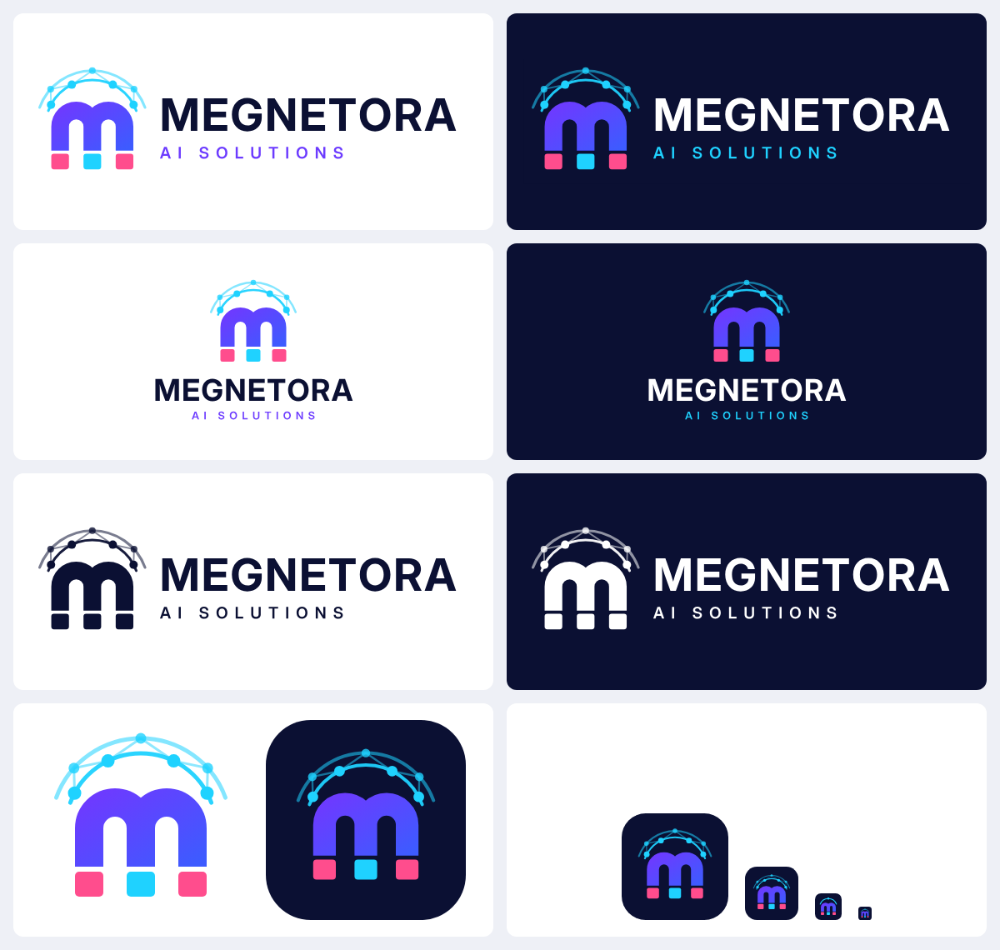
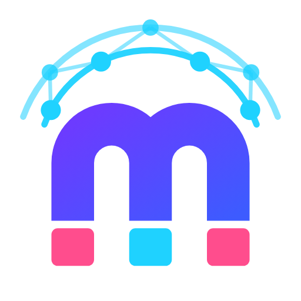

# Megnetora AI Solutions — Brand Identity



---

## 1. The name: what "Megnetora" means

**Megnetora** = **Magnet** + **-ora**

| Part | Meaning |
|---|---|
| **Megnet** (magnet) | Pull, attraction, force. We pull customers, attention, leads and revenue toward a business. |
| **-ora** | From *aura* (an energy field around something) and *era* (a new age). Latin *ōra* also means "edge" or "frontier". |

**Together:** *"The magnetic field of a new era."* An intelligent force that draws growth toward your business.

> **In Telugu:** Megnetora అంటే "కొత్త యుగపు అయస్కాంత శక్తి". మా AI టెక్నాలజీ ఒక అయస్కాంతంలా customers, leads, revenue ని మీ business వైపు ఆకర్షిస్తుంది.

---

## 2. Brand definition

> **Megnetora AI Solutions** is an AI-driven growth company. We build intelligent business solutions, AI-powered digital marketing products and data-backed business development strategies that **attract customers, automate operations and help businesses grow faster.**

### One-line definition (for bios and profiles)
**Megnetora AI Solutions: AI that attracts growth.**

### Elevator pitch (30 seconds)
Every business wants more customers, but most waste time and money on guesswork. Megnetora combines artificial intelligence with proven marketing and strategy, so businesses can find the right audience, engage them automatically, and turn insight into revenue. We act like a magnet for growth: smart, measurable and always on.

---

## 3. Taglines (pick one as primary)

1. **AI That Attracts Growth** *(recommended primary)*
2. Intelligence with Magnetic Pull
3. Attract. Automate. Accelerate.
4. Where AI Meets Business Growth
5. Pull the Future Forward

---

## 4. What we do: three service pillars

| Pillar | What it covers | Example offerings |
|---|---|---|
| **1. AI Business Solutions** | Automating and optimising how a business runs | AI chatbots and virtual assistants, workflow automation, CRM intelligence, predictive analytics, custom AI tools |
| **2. AI Digital Marketing Products** | Attracting and converting customers | AI ad optimisation, content and creative generation, SEO intelligence, social media automation, lead scoring, personalised campaigns |
| **3. Business Development Strategy** | Planning growth with data | Market research, go-to-market strategy, digital transformation roadmaps, competitor intelligence, growth consulting |

**Promise:** *Attract* the right customers → *Automate* the busywork → *Accelerate* growth.

---

## 5. Mission, vision, values

- **Mission:** Make artificial intelligence practical, affordable and profitable for every business, from startups to enterprises.
- **Vision:** Become the most trusted AI growth partner for businesses in India and around the world.
- **Values:**
  - **Intelligence:** decisions driven by data, not guesswork
  - **Attraction:** we create real value that pulls customers in naturally
  - **Transparency:** clear results, honest reporting
  - **Innovation:** always on the leading edge of AI
  - **Partnership:** your growth is our growth

---

## 6. The logo: symbolism



The symbol is a **lowercase "m" built from two horseshoe magnets**, with a **neural network field** above it.

| Element | Meaning |
|---|---|
| **"m" shape** | The Megnetora initial. Simple and easy to remember. |
| **Two joined magnets** | Attraction: pulling customers, leads and opportunities toward the business. Two magnets sharing one pole also means **partnership**: Megnetora + client working as one. |
| **Pink and cyan pole caps** | The two magnetic poles (N/S): **marketing** (pink, emotion and attraction) and **technology** (cyan, data and AI). They are opposites that attract. |
| **Arc of connected nodes** | The magnetic field drawn as a **neural network**. It stands for AI, data and connected intelligence, and also forms an *aura* / halo (the "-ora" in the name). |
| **Two field rings** | Growing reach and influence that expands outward. |
| **Violet → blue gradient** | Moving from creativity (violet) to trust and technology (blue). |

---

## 7. Colour palette

| Swatch | Name | HEX | RGB | Use |
|---|---|---|---|---|
|  | **Midnight Navy** | `#0B1033` | 11, 16, 51 | Primary text and dark backgrounds. Trust, depth. |
|  | **Magnetic Violet** | `#6C3BFF` | 108, 59, 255 | Primary brand colour. Intelligence, innovation. |
|  | **Signal Blue** | `#3D5BFF` | 61, 91, 255 | Gradient partner to violet. |
|  | **Electric Cyan** | `#1FD2FF` | 31, 210, 255 | AI, data, highlights, links on dark. |
|  | **Aura Pink** | `#FF4D8D` | 255, 77, 141 | Accent only. Calls to action, marketing energy. |
|  | **Slate** | `#5B6283` | 91, 98, 131 | Secondary text. |

**Brand gradient:** `linear-gradient(135deg, #6C3BFF 0%, #3D5BFF 100%)`

Suggested ratio: about 60% neutral (white or navy), 25% violet/blue, 10% cyan, 5% pink.

---

## 8. Typography

| Role | Font | Weight |
|---|---|---|
| Logo wordmark | **Inter Display** | Bold (700), +4% tracking |
| "AI SOLUTIONS" descriptor | Inter Display | SemiBold (600), wide tracking (+42%) |
| Headings | Inter / Inter Display | Bold / SemiBold |
| Body text | Inter | Regular (400) |

Inter is free and open-source ([Google Fonts](https://fonts.google.com/specimen/Inter)).

---

## 9. Logo files

All files are in [`logo/`](logo/). SVG is the master format (infinitely scalable, text converted to outlines). PNGs have transparent backgrounds unless the variant is "dark" or "app icon".

| File | Use it for |
|---|---|
| `megnetora-logo-horizontal-light` | Website header, letterheads, documents (on white or light backgrounds) |
| `megnetora-logo-horizontal-dark` | Dark website sections, presentations, social banners |
| `megnetora-logo-stacked-light` / `-dark` | Square spaces: posters, visiting cards, merchandise |
| `megnetora-logo-mono-black` / `-white` | Single-colour print, stamps, embroidery, engraving |
| `megnetora-icon` / `-icon-dark` | Symbol only: watermarks, stickers, social posts |
| `megnetora-app-icon` (1024/512/192 px) | Profile pictures (Instagram, LinkedIn, WhatsApp), mobile app icon |
| `megnetora-favicon` (180/64/32 px) | Browser tab icon, Apple touch icon (simplified symbol for small sizes) |

---

## 10. Logo usage rules

**Do**
- Keep clear space around the logo equal to the height of one pole cap.
- Use the light version on light backgrounds and the dark/white version on dark backgrounds.
- Use the favicon version below 48 px.
- Minimum size: horizontal logo 120 px wide (digital) / 30 mm (print).

**Don't**
- Stretch, squash or rotate the logo.
- Change the colours, or swap the pink and cyan pole caps.
- Put the colour logo on busy photos without a solid backdrop.
- Add shadows, outlines or effects.
- Retype the wordmark in a different font.

---

## 11. Regenerating the logo

The logo is generated in code, so it can be edited precisely:

```bash
pip install fonttools            # needs Inter Display installed
python3 tools/build_logo.py      # writes logo/svg/*.svg
node tools/export_png.js         # writes logo/png/*.png (needs Playwright)
```

Colours, proportions and text all live in `tools/build_logo.py`.
